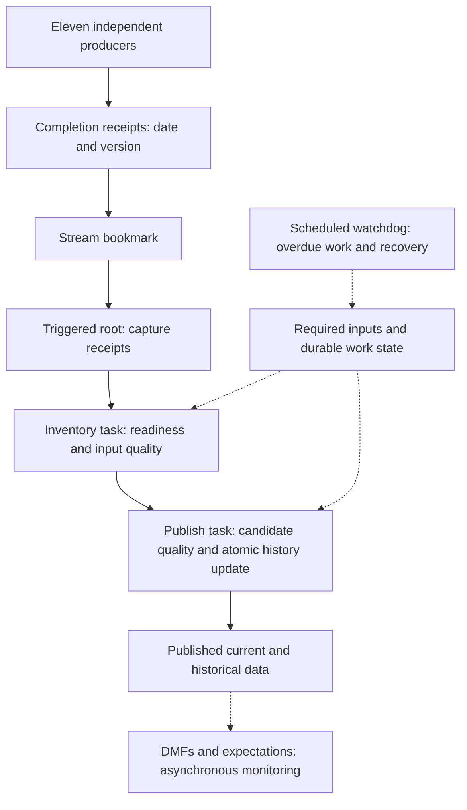

# Eleven producers, one safe publication

A customer-neutral Snowflake workshop that tackles a common data-engineering problem and walks through a native Snowflake solution.

## The problem

Many organizations run batch pipelines where multiple independent producers (data feeds, ETL jobs, file deliveries) must all complete before a downstream job can safely publish a consistent business-day result. Today this coordination typically lives in an external orchestrator — Airflow, Control-M, cron scripts, or a homegrown scheduler — that maintains its own dependency map, execution state, and retry logic outside the data warehouse.

This creates several pain points:

- **Split ownership.** The dependency graph, runtime state, and business data live in different systems. A "completed" status in the scheduler does not guarantee the right day's data actually landed, or that it landed completely.
- **Fragile completion contracts.** Partial file deliveries, duplicate events, or wrong-version data can slip through when the orchestrator only checks "did the job exit zero" rather than "are all eleven producers' outputs present, correct, and for the expected business date."
- **Difficult migration.** Replacing or upgrading the scheduler does not remove the need for a trustworthy completion contract. Teams often discover that scheduling logic and business-readiness logic are tangled together, making it hard to move one without breaking the other.

The workshop uses a concrete scenario — eleven independent producers feeding a two-stage pipeline (inventory then publication) — to make these problems tangible.

## The recommendation

Move the dependency tracking, readiness checks, and execution ordering into Snowflake using native constructs:

- **Streams and triggered tasks** replace external polling. A stream on an append-only completion-event table wakes the pipeline when new receipts arrive, without scheduled polling intervals.
- **Stored procedures with scoped transactions** enforce the business contract. Readiness is checked against a durable checklist (all required producers, correct date and version), not inferred from task scheduling metadata. Publication commits history updates and completion receipts atomically — if the transaction fails, nothing is half-published.
- **A watchdog task** handles recovery. Because business completions are tracked in persistent tables (not just stream offsets), a scheduled watchdog can find overdue work and retry it without waiting for another event.
- **Dynamic tables** are shown as a preparation-path alternative for the declarative transformation portion. They handle incremental refresh well, but do not replace the transactional publication contract where atomicity across multiple target tables matters.

The key insight is separating two concerns that external orchestrators often conflate: **running order** (which task runs next) belongs in `AFTER` edges and schedules; **business readiness** (are all eleven producers' outputs present and correct for this business date) belongs in application-level control tables checked inside the procedure.

**Start with [the workbook](docs/WORKBOOK.md)** for the concepts, then [the guided exercises](docs/HANDS_ON.md) for a 150-minute hands-on workshop. [Facilitator timing and teach-back](docs/FACILITATOR.md) are included. All example entities, producer names, dates and data are synthetic. This is an educational sample, not an official supported product or a production-ready deployment.

## What is included

- Eleven producers, `P01` through `P11`; two feed the inventory step directly, and nine feed the publishing step. This implementation deliberately applies the conservative **all-eleven gate before either job**. Earlier inventory start is a documented extension, not implemented behavior.
- Append-only completion-event stream, native task graph and an independent recovery watchdog.
- Durable receipt accumulation keyed by producer, business date and source version; duplicate events do not unlock missing dependencies.
- Synchronous null/duplicate/volume/business-total gates and protected history invariants.
- Optional native DMFs and expectations for asynchronous monitoring of published data.
- Three days of generated data: 302 input records; expected final output is 111 history versions and 101 current entities.
- Five individually callable SQL scenarios with 19 assertions, exact row-level parity, and a separate real-trigger exercise.
- Two-producer warm-up, prerequisite checks, per-script checkpoints and troubleshooting.
- Migration mapping for Airflow, Control-M and cron patterns, plus a customer cutover worksheet.
- Runnable incremental dynamic-table preparation comparison, including frozen-candidate isolation.
- Offline structural checks and an opt-in fresh-sandbox rehearsal runner with private evidence.

**Validation status: Passed on 2026-10-19 in an isolated instructor sandbox.** Measured results: 19 deterministic assertions; real stream-triggered ten-parent wait and P11 release; exact historical-row parity; incremental DT preparation comparison; two passing optional DMF expectations. See [validation scope and remaining limits](docs/VALIDATION.md). This is a sandbox pass, not production certification or proof of customer comprehension.

## Architecture at a glance



Task relationships live in `AFTER` definitions. Business readiness lives in application control tables. A stream is a wake-up signal, not proof that every input is ready. A monitor is not automatically a publication gate.

## Safe installation

1. Use an isolated, disposable sandbox account/database context. Review every script before execution. Do not use a production task-owner role.
2. Provision an appropriate installer/task-owner role. It needs database/schema/object creation, warehouse usage, and account-level `EXECUTE TASK` to run warehouse tasks. Only an authorized administrator should grant these. No account-wide grants or users are created here. Review [task security](https://docs.snowflake.com/en/user-guide/tasks-intro).
3. Run `00_preflight.sql` with your administrator; edition confirmation for optional DMFs is a manual gate. Run `00_setup.sql`, `00_warmup.sql`, `01_fixtures.sql`, `02_procedures.sql`, then `03_tasks.sql`, **stopping on the first error**. Setup intentionally fails if its database already exists. Never bypass that failure. Each script ends with expected checkpoints.
4. `00_setup.sql` creates `ELEVEN_PRODUCER_LAB.DEMO` and an X-Small `ELEVEN_PRODUCER_WH`. These generic names must be available. For a different namespace, consistently replace both names in all SQL and review the diff first.
5. All tasks start suspended. Install `05_tests.sql`, then run the five calls in `05_run_tests.sql` once, in order, on fresh fixtures. Definitions can be reinstalled; test calls mutate shared fixtures and are not independent resets. Expect 19 passing assertions. Do not wrap transaction-owning procedures in an outer transaction.
6. Optionally review and run `04_optional_dmfs.sql` (Enterprise Edition and additional data-quality privileges/costs). It is independent of the blocking quality gates.
7. Optionally run `06_live_trigger.sql` one section at a time. Wait for actual task completion; submission is not completion. It is not a run-all script.
8. Run `08_dynamic_table_alternative.sql` for the one-day preparation comparison (after deterministic tests). It uses a separate schema and suspends its DT at the end.
9. Run `07_stop.sql` **last**. It stops all four tasks, disables the optional DMF schedule, and suspends the optional DT. Inspect active executions; suspension does not cancel running work. DMF schedule changes can take ten minutes to propagate.
10. To remove all workshop objects completely, run `09_teardown.sql` after `07_stop.sql`. This drops the database and warehouse. It is irreversible — all data, procedures, and task history are lost. Rerun `00_setup.sql` afterward for a fresh sandbox.

No deployment is automatic. Nothing connects to Snowflake from opening the workbook or running the local static checker. SQL scripts are not safely re-runnable as an installer; use a new sandbox or deliberately clean up after reviewing all objects.

## Operating choices and limits

The workshop favors clarity over throughput: a single writer-control row serializes business writes. There is no claim of exactly-once message delivery; business completion checks make repeated work harmless. Candidate data is snapshotted on the inventory step and reused for publication. Restrict candidate/control-table writes in production: the lock only protects cooperating procedures.

Inventory and publication have separate transactions. If publication fails, successful inventory remains committed. No parent procedure wraps both stages in an outer transaction. The watchdog processes oldest eligible dates across successive passes; later dates wait for earlier publications. A failed batch can stop a pass, so failure notifications and operator recovery are still required.

The watchdog schedule uses Eastern wall-clock deadlines; business dates are explicit and unchanged during retries. Fixed fixture dates are historical, so enabling the watchdog now will correctly regard unfinished fixture requests as overdue. Backdated reconstruction, corrected same-day versions, source deletions, complex calendars, stress testing, retention automation and notification integrations are out of scope.

The dynamic-table alternative is executable preparation, not a second implementation of atomic history publication. See the workbook for when to choose a DT chain, tasks, or a hybrid. Eleven independent producers and eleven sequential transformation steps are different graphs; map the actual dependencies before migrating.

## Local checks

```sh
python3 tests/check_repository.py
```

These checks verify packaging, identifiers, task safety and structural safeguards. They do **not** compile Snowflake SQL or simulate transaction semantics. Runtime evidence must come from your sandbox SQL tests and task history.

## Navigation

- [Plain-English workbook and current/proposed diagrams](docs/WORKBOOK.md)
- [Guided exercises and troubleshooting](docs/HANDS_ON.md)
- [Facilitator guide and timing](docs/FACILITATOR.md)
- [Test matrix and evidence instructions](docs/TESTING.md)
- [Measured validation and limits](docs/VALIDATION.md)
- [SQL scripts](sql/)
- [Public-content and security scope](SECURITY.md)

## Official references

- [Task graphs and parent/child ordering](https://docs.snowflake.com/en/user-guide/tasks-graphs)
- [Triggered tasks](https://docs.snowflake.com/en/user-guide/tasks-triggered)
- [Stream offsets, transactions and multiple consumers](https://docs.snowflake.com/en/user-guide/streams-intro)
- [STREAM_HAS_DATA false positives](https://docs.snowflake.com/en/sql-reference/functions/system_stream_has_data)
- [Stored procedures and scoped transactions](https://docs.snowflake.com/en/sql-reference/transactions)
- [DMF setup and direct evaluation](https://docs.snowflake.com/en/user-guide/data-quality-working)
- [Expectations](https://docs.snowflake.com/en/user-guide/data-quality-expectations)

Documentation is the feature reference; sample design choices are not universal Snowflake requirements. Recheck current documentation, privileges and account availability before deployment.