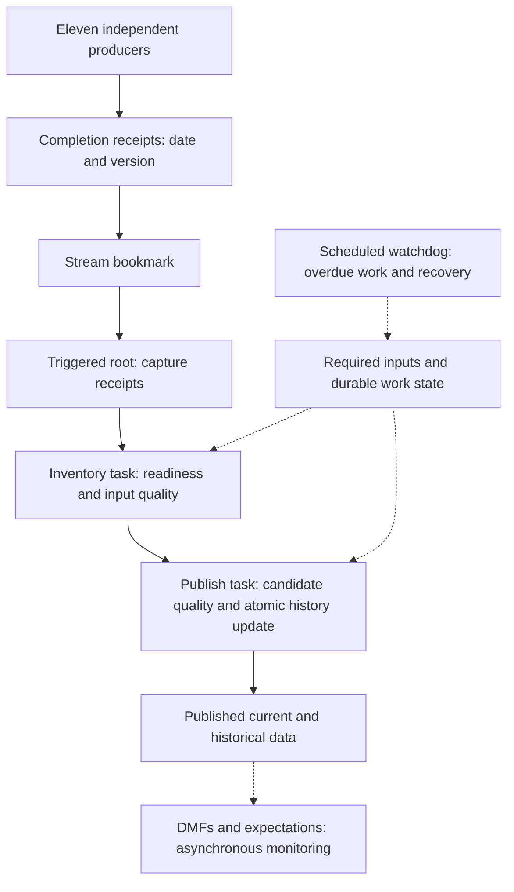

# Eleven producers, one safe publication

A customer-neutral Snowflake workshop about a common problem: eleven independent producers finish at different times, but two dependent jobs must publish one consistent business-day result.

**Start with [the workbook](docs/WORKBOOK.md).** Reading requires no Snowflake account or Python environment. All example entities, producer names, dates and data are synthetic. This is an educational sample, not an official supported product or a production-ready deployment.

## What is included

- Eleven producers, `P01` through `P11`; two feed the inventory step directly, and nine feed the publishing step. This implementation deliberately applies the conservative **all-eleven gate before either job**. Earlier inventory start is a documented extension, not implemented behavior.
- Append-only completion-event stream, native task graph and an independent recovery watchdog.
- Durable receipt accumulation keyed by producer, business date and source version; duplicate events do not unlock missing dependencies.
- Synchronous null/duplicate/volume/business-total gates and protected history invariants.
- Optional native DMFs and expectations for asynchronous monitoring of published data.
- Three days of generated data: 302 input records; expected final output is 111 history versions and 101 current entities.
- Deterministic SQL tests, separate real-trigger exercise, and a local static-check script.

**Validation status:** Static repository checks are provided and run during authoring. The new generic SQL has **not been deployed or executed end to end in Snowflake**. Expected test outcomes are specifications, not measured results. Do not infer runtime validation from older or unrelated workshops.

## Architecture at a glance



Task relationships live in `AFTER` definitions. Business readiness lives in application control tables. A stream is a wake-up signal, not proof that every input is ready. A monitor is not automatically a publication gate.

## Safe installation

1. Use an isolated, disposable sandbox account/database context. Review every script before execution. Do not use a production task-owner role.
2. Provision an appropriate installer/task-owner role. It needs database/schema/object creation, warehouse usage, and account-level `EXECUTE TASK` to run warehouse tasks. Only an authorized administrator should grant these. No account-wide grants or users are created here. Review [task security](https://docs.snowflake.com/en/user-guide/tasks-intro).
3. Run SQL files `00_setup.sql`, `01_fixtures.sql`, `02_procedures.sql`, then `03_tasks.sql`, **stopping on the first error**. Setup intentionally fails if its database already exists. Do not bypass that failure and continue in an existing database. Use a SQL client configured to stop on errors.
4. `00_setup.sql` creates `ELEVEN_PRODUCER_LAB.DEMO` and an X-Small `ELEVEN_PRODUCER_WH`. These generic names must be available. For a different namespace, consistently replace both names in all SQL and review the diff first.
5. All tasks start suspended. Run `05_tests.sql` once on fresh fixtures. It mutates data and expects specific injected errors. Investigate any failed assertion; do not alter expected results to hide a failure.
6. Optionally review and run `04_optional_dmfs.sql` (Enterprise Edition and additional data-quality privileges/costs). It is independent of the blocking quality gates.
7. Optionally run `06_live_trigger.sql` one section at a time. Wait for actual task completion; submission is not completion. It is not a run-all script.
8. Run `07_stop.sql` afterward. If DMFs were installed, disable their schedule separately as documented. Inspect active executions; suspension does not cancel running work.

No deployment is automatic. Nothing connects to Snowflake from opening the workbook or running the local static checker. SQL scripts are not safely re-runnable as an installer; use a new sandbox or deliberately clean up after reviewing all objects.

## Operating choices and limits

The workshop favors clarity over throughput: a single writer-control row serializes business writes. There is no claim of exactly-once message delivery; business completion checks make repeated work harmless. Candidate data is snapshotted on the inventory step and reused for publication. Restrict candidate/control-table writes in production: the lock only protects cooperating procedures.

Inventory and publication have separate transactions. If publication fails, successful inventory remains committed. No parent procedure wraps both stages in an outer transaction. The watchdog processes oldest eligible dates across successive passes; later dates wait for earlier publications. A failed batch can stop a pass, so failure notifications and operator recovery are still required.

The watchdog schedule uses Eastern wall-clock deadlines; business dates are explicit and unchanged during retries. Fixed fixture dates are historical, so enabling the watchdog now will correctly regard unfinished fixture requests as overdue. Backdated reconstruction, corrected same-day versions, source deletions, complex calendars, stress testing, retention automation and notification integrations are out of scope.

For a dynamic-table alternative, read the workbook: it is a design option, not an additional deployed implementation in this repository.

## Local checks

```sh
python3 tests/check_repository.py
```

These checks verify packaging, identifiers, task safety and structural safeguards. They do **not** compile Snowflake SQL or simulate transaction semantics. Runtime evidence must come from your sandbox SQL tests and task history.

## Navigation

- [Plain-English workbook and current/proposed diagrams](docs/WORKBOOK.md)
- [Test matrix and evidence instructions](docs/TESTING.md)
- [SQL scripts](sql/)
- [Public-content and security scope](SECURITY.md)

## Official references

- [Task graphs and parent/child ordering](https://docs.snowflake.com/en/user-guide/tasks-graphs)
- [Triggered tasks](https://docs.snowflake.com/en/user-guide/tasks-triggered)
- [Stream offsets, transactions and multiple consumers](https://docs.snowflake.com/en/user-guide/streams-intro)
- [STREAM_HAS_DATA false positives](https://docs.snowflake.com/en/sql-reference/functions/system_stream_has_data)
- [Stored procedures and scoped transactions](https://docs.snowflake.com/en/sql-reference/transactions)
- [DMF setup and direct evaluation](https://docs.snowflake.com/en/user-guide/data-quality-working)
- [Expectations](https://docs.snowflake.com/en/user-guide/data-quality-expectations)

Documentation is the feature reference; sample design choices are not universal Snowflake requirements. Recheck current documentation, privileges and account availability before deployment.