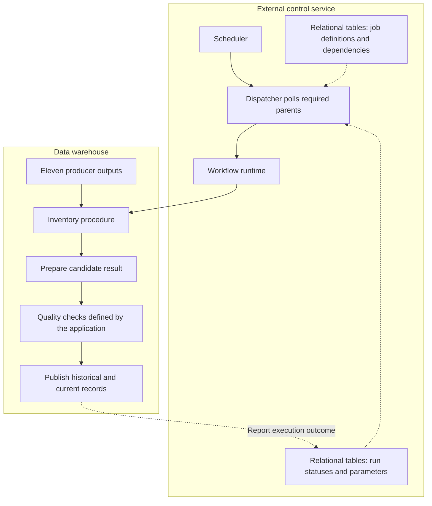
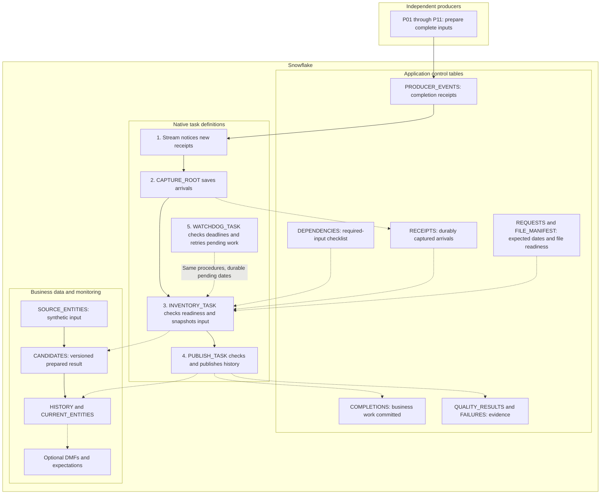
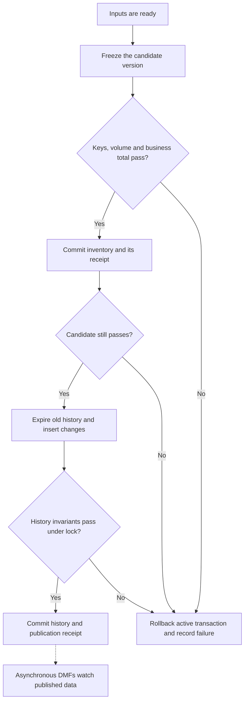

# Workshop: wait, check, publish, recover

## Start here

**Goal:** understand how eleven independent producers can safely feed a two-job pipeline without rebuilding an entire custom orchestration platform.

Read sections 1-7 in order for the design. To run it, follow [the guided hands-on exercises](HANDS_ON.md); delivery timing and teach-back questions are in [the facilitator guide](FACILITATOR.md). The full session is approximately 150 minutes. Diagrams render on GitHub; the surrounding descriptions also work in plain Markdown readers. Only explicitly installed sandbox objects are changed. Expected checkpoints and measured rehearsal results are distinguished in [VALIDATION.md](VALIDATION.md).

For editable boxes and connectors, open [architecture.drawio](architecture.drawio) in draw.io. It contains current and proposed pages. Mermaid diagrams below are the text-source alternative, not automatically synchronized with that file.

**Vocabulary:** a *producer* prepares an input; a *parent* must finish before dependent work; a *child* waits for its parents; a *business date* identifies the day being processed; a *source version* identifies that day's agreed inputs; a *receipt* records successful completion; *idempotent* means repeating a completed request does not count it twice.

## 1. Current pattern: a separate orchestration service

This is a generic architectural pattern, not a description of a named organization.

**Question:** Why is this difficult to migrate? **What happens:** the dependency map, runtime and business data are managed in different places. **Example:** a completed job status may refer to the wrong day or to partial data. **Interpretation:** replacing the scheduler does not remove the need for a trustworthy completion contract. **Decision:** identify which parts are scheduling and which are business rules before replacing anything.

## 2. Proposed placement: Snowflake owns the running order

**Running order is not readiness.** `AFTER` expresses which task runs next. `DEPENDENCIES` expresses which independent producers' data is required. The table is a design choice; a single coordinated graph may not need a duplicate dependency map. One graph has one root scheduling model and shares ownership/database/schema. Do not join independent schedules merely to avoid a small table.

The eleven producer jobs are simulated by inserting completion receipts, not by creating eleven artificial scheduled tasks. P01/P02 directly feed inventory; P03-P11 feed publication. The sample waits for all eleven before inventory as a conservative policy. Making inventory start earlier requires a job-specific readiness gate and new tests.

**Eleven producers is not eleven sequential steps.** Producers may run independently or in parallel. A customer's eleven-step chain, fan-in graph, conditional branches and external actions need to be inventoried before selecting Snowflake constructs. The mapping below is a design exercise, not an automatic conversion tool.

### Map your current orchestration concepts

| Current construct | Candidate Snowflake placement | What changes / what must remain explicit |
|---|---|---|
| Airflow dependency edges or Control-M predecessor conditions | Task graph `AFTER` edges | Same-graph execution order; does not prove external inputs match a business date. |
| Airflow sensor, Control-M file/event condition, cron polling loop | Stream-triggered capture plus durable readiness | Arrival is a wake-up signal. File completeness, date, version and watermark remain application contracts. |
| cron timing or scheduled SQL job | Scheduled root task | Choose interval versus calendar schedule deliberately; holidays and blackout rules need a defined calendar. |
| SQL transformations currently run by scripts/operators | Dynamic-table chain where declarative SELECTs fit; procedures/tasks where transactions or side effects are needed | Convert and validate business SQL separately from orchestration. This sample does not translate arbitrary source code. |
| Scheduler execution status | TASK_HISTORY plus business COMPLETIONS | Task success can mean WAIT. Business completion records must commit with business output. |
| Retry policy | Task retries plus idempotent business procedures | Retries do not supply idempotency or repair bad inputs. Preserve the original date/version. |
| SLA timer or missing-input alert | Expected REQUESTS, deadlines, watchdog and production notification integration | A producer that emits nothing needs a pre-registered expectation. This lab records warnings; it does not notify an operator. |
| Airflow XCom or scheduler parameters | Explicit request identity; optionally native task graph CONFIG/return values | Do not treat task metadata as an immutable business-data snapshot. This sample uses control tables, not XCom emulation. |
| External API/script execution or cross-platform workflow | Retain an external orchestrator or separately supported execution mechanism | Snowflake tasks do not automatically replace every external runtime or business calendar. |
| History update and audit receipt | Transactional publisher | Define correction/deletion/backfill semantics before cutover. DT preparation does not make multiple target writes atomic. |

These are conceptual mappings, not drop-in equivalence claims for every Airflow or Control-M configuration. Verify actual source-tool semantics, retry boundaries and calendars with the current owner. Native task/stream mechanics are described in the [task graph](https://docs.snowflake.com/en/user-guide/tasks-graphs) and [stream](https://docs.snowflake.com/en/user-guide/streams-intro) references.

### Worked example: a customer's eleven-step workflow

This example describes a migration decomposition; the executable sample below implements only the receipt/readiness, preparation and publication pattern.

| Existing step | Proposed responsibility | Evidence needed before migration |
|---|---|---|
| 1. Receive files | Existing ingestion path plus file manifest | Complete delivery, not first file arrival |
| 2. Parse input | Validated ingestion SQL/tool | Rejected-row and schema handling parity |
| 3. Normalize keys | Declarative preparation / DT | Null, casing and type semantics |
| 4. Deduplicate | Business-approved transformation | Agreed survivor policy; this lab rejects duplicates |
| 5. Join reference data | Preparation / DT | Versioned reference snapshot and unmatched-key rules |
| 6. Calculate eligibility | Preparation / DT or procedure | Row-by-row comparison; executable sample uses two Boolean requirements |
| 7. Wait for independent feeds | Durable readiness contract | Every required producer/date/version/watermark |
| 8. Freeze and quality-check result | Inventory-stage transaction | Immutable candidate, thresholds and accepted snapshot |
| 9. Update history | Publish-stage transaction | Interval boundaries, changed/new/unchanged rows |
| 10. Commit published completion | Same publish transaction | No success receipt on rollback |
| 11. Notify and monitor | Monitoring plus approved notification channel | Measured delivery, escalation owner and deadline tests |

Do not create eleven tasks just because the old workflow had eleven boxes. Merge trivial compatible SQL steps, split at meaningful failure/transaction boundaries, and retain external steps where appropriate. Likewise, do not collapse eleven independent producers into a single artificial chain.

### Migration sequence and cutover gates

1. **Inventory the real graph.** For each node record inputs, outputs, parent IDs, date/version parameters, schedule, side effects, execution owner, and retry boundary. Mark which steps must stay external.
2. **Write the contract.** Define source-complete evidence, immutable versions, deadlines, deletions, corrected days, historical reconstruction and ordering. The sample's all-eleven gate is deliberately conservative, not a universal requirement.
3. **Choose one bounded slice.** Port one preparation query and its publication contract. Use the warm-up, then the full lab, then the DT comparison to select the right boundary.
4. **Shadow-run matched inputs.** Keep the old output authoritative. Compare keys, values, types, totals and history intervals in both directions on the same snapshot, including late and bad inputs. Row counts alone are insufficient.
5. **Prove operations.** Test missing producers, duplicate receipts, bad data, retry after commit, empty-stream recovery, concurrency and operator notification. Define acceptable latency and cost with measured workload scale.
6. **Cut over one consumer at a time.** Obtain a named owner's sign-off on parity and recovery. Pause the old publisher before enabling the new writer; keep a single authoritative publisher. Retain the old output and configuration for an agreed rollback window.
7. **Rollback deliberately.** If agreed parity, freshness or correctness gates fail, stop the new publisher, confirm no in-flight writes, reconcile checkpoints, and restore the old consumer route. Avoid simultaneously replaying both writers into the same target. Do not delete evidence during rollback.

**Customer exercise:** pick one actual workflow and fill in the fields from step 1 for every node. For each edge identify whether it represents execution order, data completeness, or an external side effect. A participant should be able to explain their mapping without pointing at the sample's generic P01-P11 labels.

## 3. Walk through one business day

1. **Register expected work.** REQUESTS states which date/version should complete, its deadline and expected quality totals. Without expected work, a producer that never emits a receipt is invisible to an event-only system.
2. **Receive completion receipts.** Producers report success only after the relevant output is complete. Native producers should commit output and receipt together. External producers need a trustworthy equivalent signal. Synthetic fixtures deliberately separate these to exercise orchestration.
3. **Capture arrivals.** The append-only stream tracks inserted receipts. CAPTURE_EVENTS inserts them into RECEIPTS and commits. The stream is a bookmark, not another permanent copy of the records.
4. **Check readiness.** Match every required producer, date, version and watermark; verify the named required file. Duplicates count as one producer. Success with zero changed rows can still be valid.
5. **Snapshot and validate input.** Inventory builds CANDIDATES once for this request, checks it and records its own successful work atomically. Publication uses that same version, not a new source read.
6. **Publish safely.** Validate the candidate again, calculate changed entities, close old history versions and add new ones. Check final history invariants while holding the writer lock. Commit history and publication receipt together.
7. **Recover and monitor.** A consumed stream does not mean business work completed. REQUESTS minus COMPLETIONS remains the durable to-do list. The watchdog can recover without waiting for another event.

**Question:** Ten parents have finished; what should happen? **Example:** the missing parent P11 arrives later. **Expected result:** WAIT first, then processing after the last valid receipt and file readiness. **Interpretation:** a green capture task can coexist with unfinished business work. **Decision:** define readiness by job/date/version, not table modification time.

## 4. Quality is a separate gate

| Check | Location | Sample acceptance rule | Failure action |
|---|---|---|---|
| Missing entity IDs or derived status | RUN_STAGE candidate gate | Zero | Roll back this job and raise an error |
| Duplicate entity IDs | RUN_STAGE candidate gate | Zero | Do not silently choose a survivor |
| Candidate volume | REQUESTS + RUN_STAGE | Exactly 100 or 101 for fixtures | Stop; real thresholds must be business-approved |
| Eligible total | REQUESTS + RUN_STAGE | 0 on day 1; 11 later | Stop on mismatch |
| Multiple current versions / bad or overlapping intervals | Publish transaction | Zero | Roll back history and publication receipt |
| Missing/duplicate published IDs | Optional DMFs + expectations | VALUE = 0 | Record violations; not an automatic task blocker |

**Question:** All parents succeeded but input has duplicate IDs. **What happens:** readiness passes, quality rejects the batch. **Expected evidence:** a failed QUALITY_RESULTS row and no completion for the failed job. **Interpretation:** missing or errored critical checks are not passes. **Decision:** agree which rules stop, warn, or quarantine; this sample stops rather than publishing a partial result.

DMFs measure quality; expectations define acceptable values. Scheduled monitoring is asynchronous. A pipeline must explicitly evaluate a current check if it needs synchronous blocking. The optional monitor watches only current entities; applying duplicate-ID monitoring to all SCD2 history would flag intentional historical versions.

## 5. Failure and recovery without double counting

**Question:** What if publication fails after closing old versions? **What happens:** the publisher rolls back its transaction. Inventory remains committed because it is a separate job. **Expected result:** last good history remains visible; no publication receipt exists. **Interpretation:** the whole pipeline is not one transaction. **Decision:** recover the failed date/version; do not advance the business date during retry.

The lock is a real UPDATE to a pre-existing writer row, not an unenforced primary-key declaration. Completion is checked after taking the lock. Candidate/control-table writes must be restricted to cooperating writers in production. The procedures intentionally avoid nested outer transactions holding the same lock while calling independently committing jobs.

**Stream exercise:** plain SELECT does not advance the stream. A consuming INSERT does, even if it is only recording a test count or filters rows out. The test reads counts into variables, then writes assertions from those variables. Injected capture rollback must leave all ten unconsumed events available.

**Watchdog exercise:** capture all events, then fail publication. The stream may be empty while work remains unfinished. Fix the problem and run the watchdog: it checks durable requests and receipts, not just new events. Automatic task retries complement this behavior; they do not replace idempotency or recovery after a fresh invocation.

## 6. Dummy data and expected results

| Business day | Synthetic change | Expected history after publication |
|---|---|---|
| Day 1: Jan 6, 2025 | Entities 1-100; none eligible | 100 versions, 100 current |
| Day 2: Jan 7, 2025 | Entities 1-10 become eligible; add eligible entity 101 | 111 versions, 101 current |
| Day 3: Jan 8, 2025 | No changes | Still 111 versions, 101 current |

**Question:** Should another run add another historical row? **What happens:** completed job/date/version returns NOOP. **Expected result:** entity counters are 3 for 1-100 and 2 for 101; six job receipts for the three days. **Interpretation:** history changes only when the business value changes. **Decision:** define correction, deletion and historical-rebuild policy separately; those are deliberately rejected or out of scope here.

These numbers describe the generated fixture, not a customer's data. See [guided execution](HANDS_ON.md), [test instructions](TESTING.md) and [measured validation](VALIDATION.md).

## 7. Choose a bounded pilot

Fill the blank cells together with the customer; they are intentionally empty. Record an owner and a measurable acceptance criterion, not just a preferred feature.

| Decision | Record the agreed rule / owner |
|---|---|
| All eleven before inventory, or only its two direct parents? | |
| What proves complete source and file delivery? | |
| Who controls the immutable candidate version? | |
| Which quality rules stop versus warn? | |
| Who handles late data and failed checks? | |
| How are corrected versions and backfills approved? | |
| Which matched input snapshots prove parity with the old process? | |
| Who approves cutover and rollback? | |

Run [08_dynamic_table_alternative.sql](../sql/08_dynamic_table_alternative.sql) for a working one-day preparation comparison: 101 rows, 11 eligible, exact parity with the procedural candidate. A controlled source mutation demonstrates why fresh prepared data and approved published data are different. It does not replace the full transactional publisher; select a pure DT chain for declarative transformations, or a hybrid for this explicit publication contract. See [the hands-on instructions](HANDS_ON.md#6-compare-a-dynamic-table-preparation-path).

## Optional technical appendix

Follow the root README for exact script order and safety controls. All tasks are suspended at installation. No account profile is included. Setup is not idempotent: do not rerun against an existing installation. Reading this workbook never executes SQL.

Monitor task history by exact task/database/schema and run identity. Inspect both business COMPLETIONS and task history: a task returning WAIT is successful orchestration, not a published batch. Keep stream consumption within retention; independent consumers need independent streams. No external email/webhook is configured.

Official sources: [task graphs](https://docs.snowflake.com/en/user-guide/tasks-graphs), [triggered tasks](https://docs.snowflake.com/en/user-guide/tasks-triggered), [streams](https://docs.snowflake.com/en/user-guide/streams-intro), [DMFs](https://docs.snowflake.com/en/user-guide/data-quality-working), [expectations](https://docs.snowflake.com/en/user-guide/data-quality-expectations).